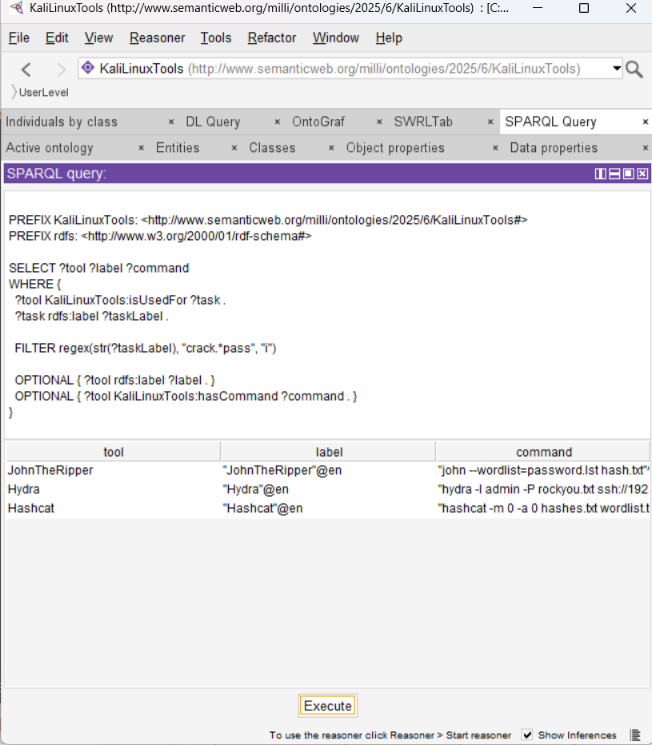
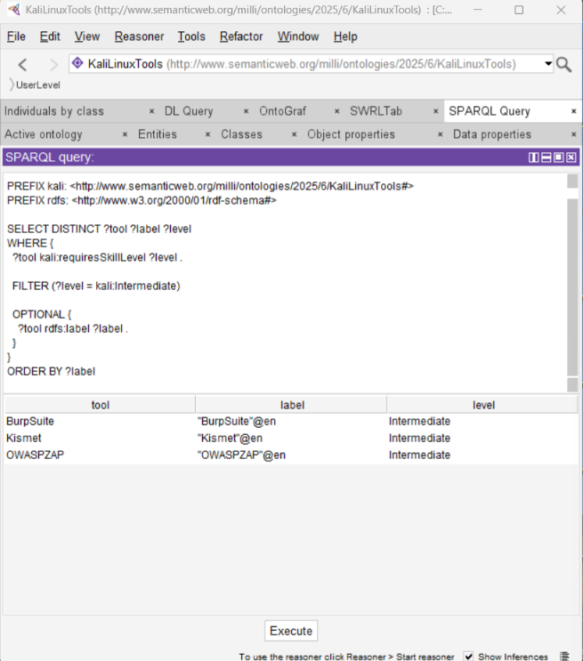
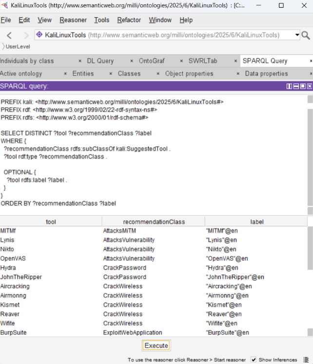
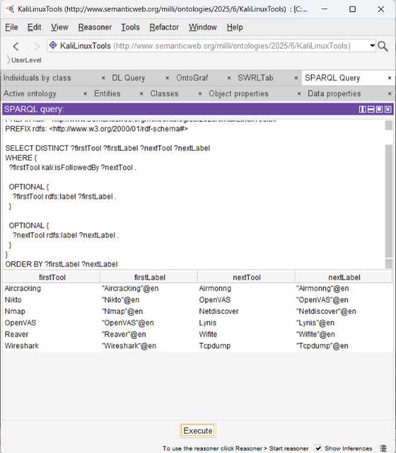
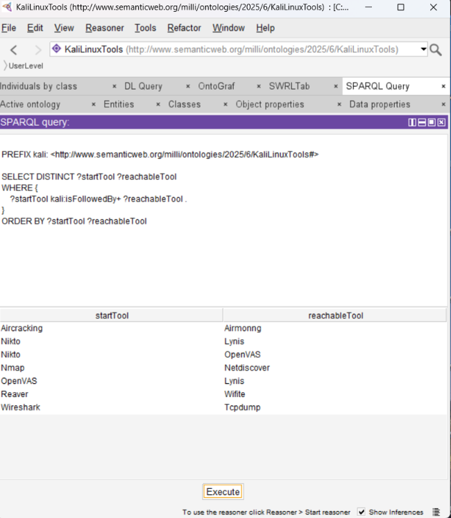
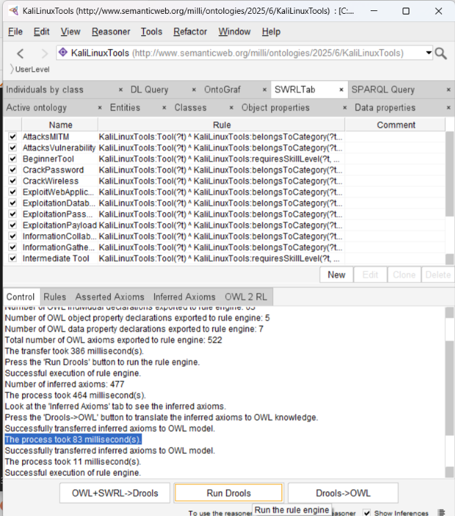

# Research Validation Evidence

## Research Project

**Title:** A Semantically Developed Knowledge-Based System for Deploying Kali Linux Tools

**Researcher:** Effiong Okon Antai  
**Institution:** Nottingham Trent University, United Kingdom  
**Programme:** MSc Cybersecurity  
**Original Research:** September 2025  
**Additional Validation:** October 2026

## Overview

This folder contains technical evidence demonstrating the implementation and validation of an ontology-based Knowledge-Based System (KBS) for recommending Kali Linux cybersecurity tools.

The research uses Semantic Web technologies, including OWL, RDF, SWRL, SPARQL and Description Logic.

The screenshots document tests performed using Protégé, SWRLTab and the Drools rule engine.

The original MSc research was completed in 2025. Additional semantic reasoning and SPARQL validation were performed in October 2026.

---

## 1. Password-Cracking Tool Retrieval

**Query File:** [password_cracking.rq](../queries/password_cracking.rq)

**Objective:** Retrieve cybersecurity tools associated with password-cracking tasks.

### Verified Results

| Tool | Result |
|---|---|
| Hashcat | Retrieved |
| Hydra | Retrieved |
| JohnTheRipper | Retrieved |

**Status:** PASS — 3 tools retrieved.

### Validation Screenshot

[Open Password-Cracking Screenshot](password_cracking_verified.png)

---

## 2. Skill-Level Filtering

**Query File:** [skill_level_filtering.rq](../queries/skill_level_filtering.rq)

**Objective:** Retrieve tools associated with the Intermediate user experience level.

### Verified Results

| Tool | Skill Level |
|---|---|
| BurpSuite | Intermediate |
| Kismet | Intermediate |
| OWASPZAP | Intermediate |

**Status:** PASS — 3 tools retrieved.

### Validation Screenshot

[Open Skill-Level Screenshot](skill_level_filtering_verified.png)

---

## 3. SWRL-Based Suggested Tool Classifications

**Query File:** [suggested_tools.rq](../queries/suggested_tools.rq)

**Objective:** Retrieve recommendation-related tool classifications after executing SWRL rules.

### Examples of Verified Results

| Tool | Inferred Classification |
|---|---|
| Hydra | CrackPassword |
| JohnTheRipper | CrackPassword |
| Nikto | AttacksVulnerability |
| OpenVAS | AttacksVulnerability |
| Lynis | AttacksVulnerability |
| BurpSuite | ExploitWebApplication |
| MITMf | AttacksMiTM |
| Kismet | CrackWireless |
| Reaver | CrackWireless |
| Wifite | CrackWireless |

**Status:** PASS — inferred classifications retrieved.

### Validation Screenshot

[Open Suggested-Tools Screenshot](suggested_tools_verified.png)

---

## 4. Direct Tool-Sequencing Relationships

**Query File:** [tool_sequencing.rq](../queries/tool_sequencing.rq)

**Objective:** Retrieve direct tool-to-tool relationships represented by the `isFollowedBy` object property.

### Verified Results

| First Tool | Next Tool |
|---|---|
| Aircracking | Airmonng |
| Nikto | OpenVAS |
| Nmap | Netdiscover |
| OpenVAS | Lynis |
| Reaver | Wifite |
| Wireshark | Tcpdump |

**Status:** PASS — 6 direct relationships retrieved.

### Validation Screenshot

[Open Tool-Sequencing Screenshot](tool_sequencing_verified.png)

These relationships are represented in the ontology and are not independently validated as optimal operational workflows.

---

## 5. Direct and Indirect Tool Reachability

**Query File:** [tool_reachability.rq](../queries/tool_reachability.rq)

**Objective:** Identify tools reachable through one or more `isFollowedBy` relationships.

The query uses the SPARQL property-path operator `+` to identify direct and indirect relationships.

### Verified Results

| Starting Tool | Reachable Tool | Relationship |
|---|---|---|
| Aircracking | Airmonng | Direct |
| Nikto | Lynis | Indirect |
| Nikto | OpenVAS | Direct |
| Nmap | Netdiscover | Direct |
| OpenVAS | Lynis | Direct |
| Reaver | Wifite | Direct |
| Wireshark | Tcpdump | Direct |

**Status:** PASS — 7 reachable pairs retrieved.

### Example of Indirect Reachability

Nikto → OpenVAS → Lynis

The ontology represents direct relationships between Nikto and OpenVAS, and between OpenVAS and Lynis.

The reachability query also identifies the indirect connection from Nikto to Lynis.

### Validation Screenshot

[Open Tool-Reachability Screenshot](tool_reachability_verified.png)

---

## 6. SWRL Drools Reasoning Validation

**Environment:** Protégé Desktop, SWRLTab and Drools.

**Objective:** Execute SWRL rules and transfer inferred assertions into the ontology.

### Recorded Validation Results

| Measurement | Result |
|---|---|
| SWRL rules exported | 18 |
| OWL classes exported | 31 |
| OWL individuals exported | 63 |
| Object property declarations | 5 |
| Data property declarations | 7 |
| OWL axioms exported | 522 |
| Inferred axioms reported | 477 |
| Execution time | 464 ms |
| Rule execution | Successful |
| Inference transfer | Successful |

The inferred axiom count represents the rule engine's reported output, not the number of unique cybersecurity tool recommendations.

### Validation Screenshot

[Open SWRL Drools Screenshot](swrl_drools_validation.png)

---

## 7. Overall Validation Summary

| Validation Test | Result | Status |
|---|---|---|
| Password-Cracking Retrieval | 3 tools | PASS |
| Skill-Level Filtering | 3 tools | PASS |
| Suggested-Tool Classification | Inferred classifications retrieved | PASS |
| Direct Tool Sequencing | 6 relationships | PASS |
| Direct and Indirect Reachability | 7 pairs | PASS |
| SWRL Drools Execution | 477 inferred axioms reported | PASS |

## 8. Research Limitations

The screenshots demonstrate observed results in the Protégé research environment.

The research prototype has not been independently certified or deployed as a commercial cybersecurity recommendation system.

The tool-sequencing and reachability results reflect relationships defined within the ontology, rather than independently verified operational workflows.

## 9. Research Documentation

- [Return to Main Research README](../README.md)
- [View SPARQL Query Documentation](../queries/README.md)
- [View Original Research Ontology](../kali_linux_tool_recommendation_ontology.owl)
- [View 2026 Inferred Ontology](../kali_linux_tool_recommendation_inferred.owl)

---

**Researcher:** Effiong Okon Antai  
**Research Area:** Cybersecurity, Semantic Web Technologies and Knowledge-Based Systems.
